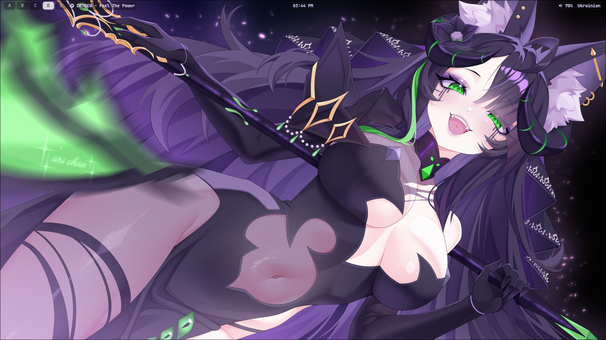
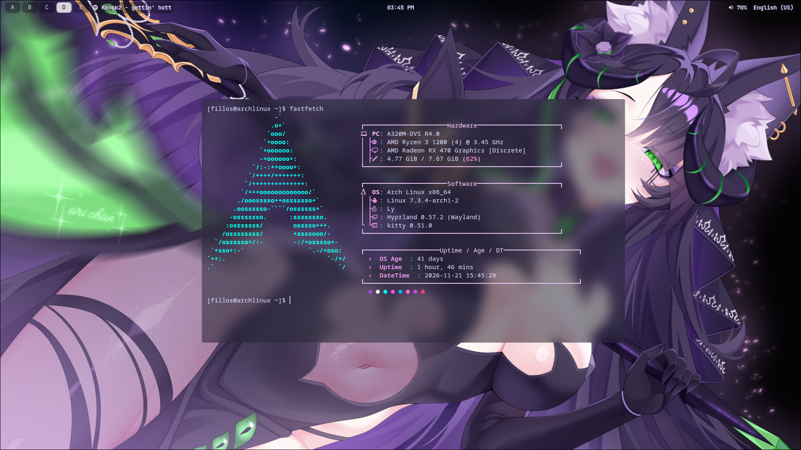
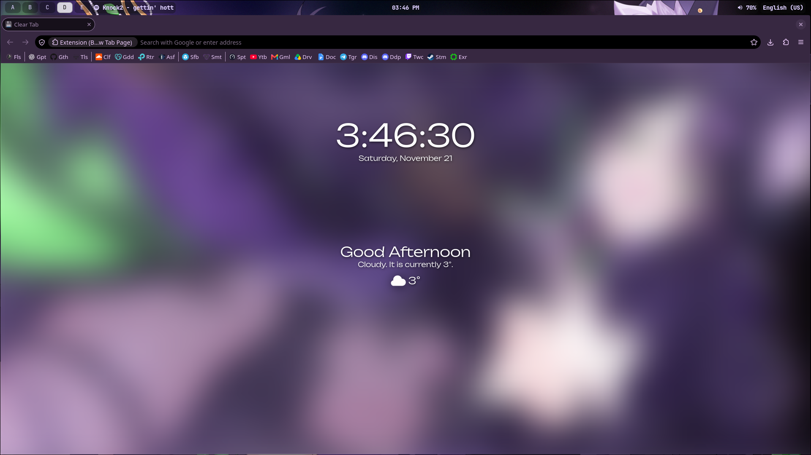

# PURPLE HYPR RISE

A personal **Arch Linux + Hyprland** desktop configuration built around a deep-purple aesthetic, transparent surfaces, custom Waybar modules, terminal theming and a practical keyboard-driven workflow.

> Personal setup. Made to be used, tweaked and broken until it feels right.

---

## Preview

<p align="center">
  
</p>

<p align="center">
  
  
</p>

---

## Highlights

- **Hyprland** — Lua-based configuration, animations, gestures, keybindings and window rules.
- **Purple visual identity** — dark surfaces, vivid accents, transparency and blur.
- **Waybar** — custom layout, modules, typography and styling.
- **Kitty + Cava** — themed terminal and audio visualizer.
- **Fastfetch** — customized system information display.
- **Desktop integration** — Qt6ct, GTK font settings, clipboard history, notifications and OSD.
- **Wallpaper setup** — animated wallpaper support through mpvpaper.

## Stack

| Area | Components |
|---|---|
| Compositor | Hyprland |
| Bar | Waybar |
| Terminal | Kitty |
| Launcher | Hyprlauncher, Rofi |
| System info | Fastfetch |
| Audio visualizer | Cava |
| Notifications / OSD | SwayNC, SwayOSD |
| Clipboard | Cliphist |
| Qt appearance | Qt6ct |
| Wallpaper | mpvpaper |
| Screenshot workflow | grim, slurp, Swappy |
| Media controls | Playerctl |

Some tools are optional and can be removed from the configuration if you do not use them.

## Typography

The setup uses different typefaces for different parts of the desktop:

| Component | Typeface |
|---|---|
| Kitty | Unbounded Nerd Font |
| Waybar | SF Pro Display |
| Waybar fallback | JetBrainsMono Nerd Font Propo |
| Qt applications | Unbounded |
| GTK interface | Noto Sans |

Install the fonts separately before applying the configuration. Font package names may differ depending on the source you use.

To restore the GTK interface font:

```bash
./scripts/set-font.sh
```

## Installation

This repository is a personal configuration, not a universal installer. Review the files before copying them: some settings (monitor output, wallpaper paths, autostart commands and installed applications) are specific to my machine.

```bash
git clone https://github.com/Fillos-A98/Purple-Hypr-Rise.git
cd Purple-Hypr-Rise
```

Install the required Arch Linux packages:

```bash
bash scripts/install-dependencies.sh
```

The installer uses `pacman` for official repository packages and `yay` or `paru` for AUR packages. Install an AUR helper first if you want it to install `mpvpaper` automatically.

Back up your existing configuration, then copy the included configs:

```bash
mkdir -p ~/.config
cp -r config/* ~/.config/
cp .bashrc ~/.bashrc
cp .bash_profile ~/.bash_profile
```

Apply the GTK font setting:

```bash
chmod +x scripts/set-font.sh
./scripts/set-font.sh
```

Log into Hyprland and adjust the machine-specific values before relying on the setup.

## Repository layout

```text
Purple-Hypr-Rise/
├── config/
│   ├── cava/
│   ├── fastfetch/
│   ├── hypr/
│   ├── kitty/
│   ├── qt6ct/
│   └── waybar/
│   └── swaync/
├── scripts/
│   ├── install-dependencies.sh
│   └── set-font.sh
├── screenshots/
├── .bashrc
├── .bash_profile
└── README.md
```

## Customization notes

- Update the monitor name and resolution in the Hyprland configuration.
- Change wallpaper paths and autostart commands to match your system.
- Install the fonts listed above separately; SF Pro Display and Unbounded Nerd Font are not installed by the dependency script.
- Review keybindings and scripts before using them.

The wallpaper shown in the earlier screenshots is available [here](https://drive.google.com/drive/folders/1ubTPX-AHSEwgFKzmN4rK6RSA_vKdBR9p?usp=sharing). The wallpaper itself is not included in this repository.

## License

MIT
